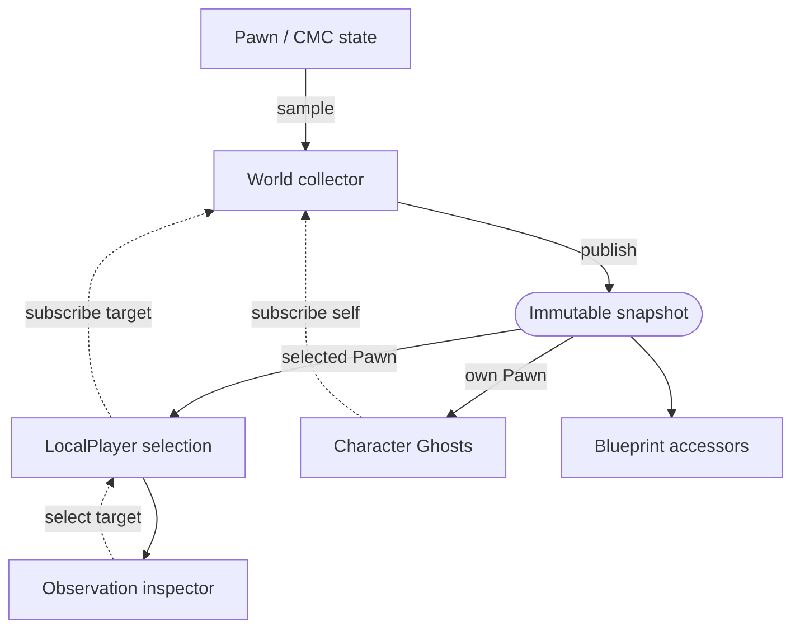
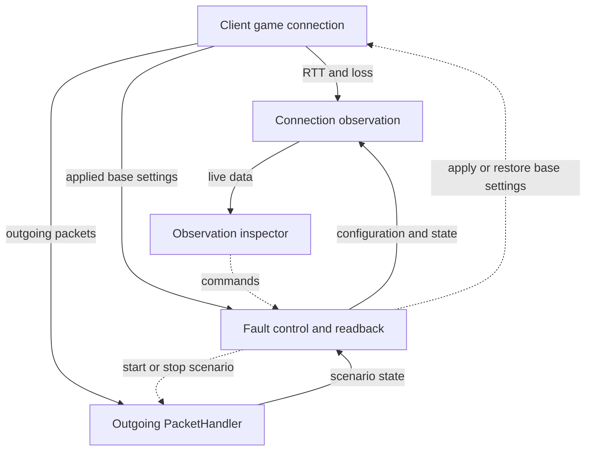
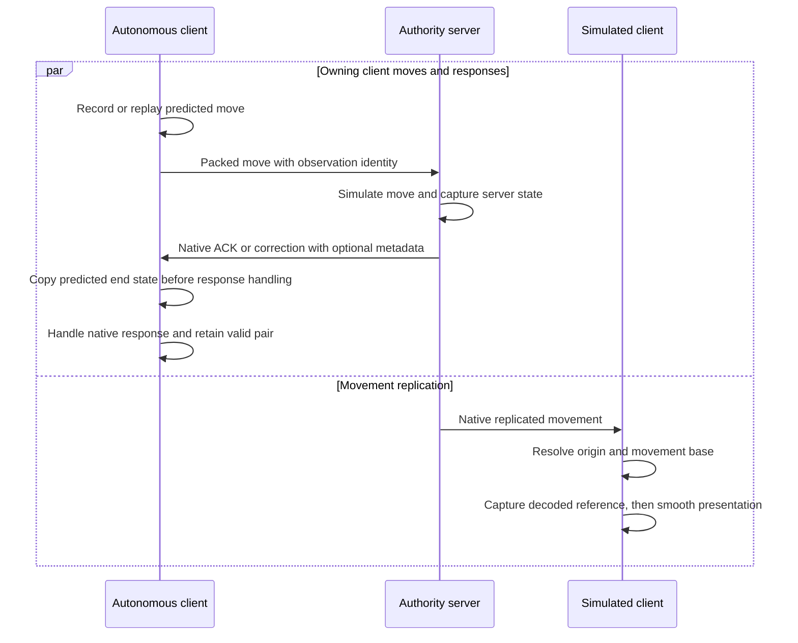

# NetReconcile — Unreal Engine Network Prediction Observatory

NetReconcile is an Unreal Engine project for observing native character network prediction, server reconciliation, and simulated proxy smoothing under controlled network faults.

Use the Observatory to compare a client's prediction with the server's state for the same move, inspect movement received for remote characters, and see how latency, loss, and queued packets affect recovery.

- [Getting started](#getting-started)
- [Using the inspector](#using-the-inspector)
- [Reading observation data](#reading-observation-data)
- [Architecture](#architecture)
- [Development and verification](#development-and-verification)

## Getting started

1. Check the engine association and enabled plugins in [NetReconcile.uproject](NetReconcile.uproject). Open the project with the matching Unreal Engine installation and build its C++ code when prompted, using the toolchain required by that engine.
2. Open `Lvl_Observation` from the [Observatory content directory](Content/Variant_NetworkPredictionObservatory). Its World Settings select the observation game mode.
3. In the Editor's Play settings, choose **Play As Client** and run multiple clients to inspect both controlled and remote characters. Clients can run in the same process.

Each local player receives an inspector for its own viewport. A dedicated server supplies authoritative movement without creating an inspector.

Fault controls require an open client game connection and a build with network emulation enabled. Outgoing scenarios also require the GameNetDriver packet handler profile in [the project configuration](Config/DefaultEngine.ini). Recreate the connection after changing that profile. The interface explains when a source or control is unavailable.

## Using the inspector

### Scene controls and editing

| Action | Interaction |
| --- | --- |
| Open or close the detailed inspector | Press **F2**. Expanding it keeps scene controls available. |
| Enter or leave editing mode | Press **Left Alt** once while the inspector is expanded. Release it before typing; press it again to return to scene controls. |
| Inspect another character | Use the target selector to pin an observation character in the same World. Select **Self** to follow possession again. |
| Hold a state for comparison | Use **Freeze snapshot**; use **Resume live** to return to live observation. |

Editing shows the cursor and consumes the owning player's game input while simulation continues. Other local players sharing the viewport can continue controlling their characters. F2 and Left Alt work while text fields or dropdowns have focus. Losing input focus releases editing mode.

Target selection belongs to each local player. Losing a pinned character resumes possession following. Connection metrics and fault controls describe the inspecting client's connection throughout target changes; local players sharing that connection share its faults.

The State view shows the selected role's motion, presentation, and response information. Saved moves are available for autonomous prediction. Ghosts reuse the character's Mesh and current bone pose to visualize captured transforms. They remain live independently of selection and inspector expansion; follow the on-screen legend to identify their sources.

Freezing retains the displayed state and Saved moves. Connection metrics, faults, simulation, and Ghosts continue updating. Returning to live observation, closing the inspector, or changing or losing its observation source releases the frozen view.

### Network faults

Base settings configure Unreal's native outgoing and incoming packet simulation. Outgoing scenarios model conditions such as burst loss, blackout, latency spikes, and bandwidth limits. Use the interface's field descriptions for units, parameter precedence, and supported options.

| Control | Effect |
| --- | --- |
| Apply base | Apply the complete base settings draft. |
| Run scenario | Start the scenario draft, replacing the previous scenario. |
| Stop scenario | Stop the scenario while retaining base settings. |
| Restore original | Restore the base settings captured before the first application and stop the scenario. |
| Revert a draft | Read the current applied configuration back into the editor controls. |

Drafts and applied settings are separate. External configuration updates preserve unsubmitted edits, and invalid inputs leave the running configuration intact.

Delayed packets retain their contents and order in a bounded queue. Stopping or replacing a scenario releases queued packets on the same open connection. Disconnect, connection replacement, travel, and World teardown discard the old backlog. The interface exposes queue and drop counters for interpreting the resulting behavior.

## Reading observation data

### Network roles

Roles are local to the World where a character is observed. The same networked character can have different roles on the server and on different clients.

| Local role | Observation | Ghost comparison |
| --- | --- | --- |
| Autonomous Proxy | The owning client's current prediction, unacknowledged Saved moves, and accepted server responses. | Server state and the matching predicted end state for the same acknowledged move. |
| Simulated Proxy | The last decoded network reference, current unsmoothed capsule state, and smoothed Mesh presentation. | Decoded reference and current capsule state; the original Mesh displays smoothing. |
| Authority | Current local authoritative motion and presentation. | The character displays its authoritative state directly. |

Autonomous comparisons pair states using a move identity that survives native timestamp resets. Prediction is copied immediately before response handling, including changes from earlier replay. The server state was sampled for that move and arrives with its response. Unacknowledged history is a separate view.

A valid pair can remain available after a newer response arrives without usable observation metadata. The last valid correction is retained separately from later good acknowledgements. Read the response and sample information when judging how recent a comparison is.

For simulated proxies, the reference is the pose decoded on the observing client after resolving its World origin and movement base. Its receipt time and age describe that local reference. Mesh presentation shows how the client smooths movement around its capsule state.

### Sources, coordinates, and time

- **Immutable snapshots:** subscribers share the same captured frame. A frozen view retains that frame while later observations continue.
- **Source availability:** waiting, missing, unsupported, and inapplicable data have explicit status. Zero and false are valid measured values when their source is available.
- **Coordinates:** captured poses use zero-origin World positions. Drawing converts them to the current local origin, so comparisons survive origin rebasing.
- **Clocks:** local game time, monotonic real time, server game time, and native movement timestamps have distinct meanings. Game pause retains Pawn samples while connection observation and fault timing continue.
- **Measured and configured values:** RTT and loss come from native measurement windows. Jitter is a native estimate with timing uncertainty. Configured latency and scenario delay describe settings; runtime queues show additional waiting.
- **Input and motion:** input requests and Saved move command summaries accompany actual captured movement. Mesh presentation supplies a visual pose; motion values come from the Pawn and movement component.

The [observation model](Source/NetReconcile/Variant_NetworkPredictionObservatory/Character/Model) defines the precise data contracts.

## Architecture

CMC means Unreal's `CharacterMovementComponent`. The diagrams show responsibilities and data flow; solid arrows carry data or packets, and dashed arrows indicate local control actions.

### Pawn sampling and consumers

A World collector samples subscribed Pawns during normal, unpaused game frames. Each frame combines common local state with the payload appropriate to that Pawn's role. Local-player inspectors and character Ghosts consume the shared snapshot.

Selection determines which Pawn an inspector consumes. Each character's Ghosts subscribe to its own Pawn. UI freeze retains a displayed snapshot without changing either subscription's live sampling.

### Connection observation and fault control

Connection observation belongs to the client World and is shared by local players using its game connection. Fault control manages native base settings and the outgoing PacketHandler scenario, and supplies their configuration readback.

The PacketHandler runs with the connection's network timing. Connection observation and faults remain independent of Pawn selection, game pause, and frozen UI snapshots.

### Native movement exchange

The observation movement component captures diagnostic metadata within Unreal's existing packed move and response exchange. Client and server must use compatible observation protocol implementations.

These exchanges progress independently. Each observing World publishes its local frames to its consumers. Native acknowledgement continues when diagnostic metadata is unavailable; a previously valid observation pair remains available.

## Development and verification

Start with the [Observatory source directory](Source/NetReconcile/Variant_NetworkPredictionObservatory). Use the relevant area as the source of truth for interfaces and implementation details:

| Area | Responsibility |
| --- | --- |
| [Character](Source/NetReconcile/Variant_NetworkPredictionObservatory/Character) | World sampling, local-player selection, native movement hooks, and Ghosts. |
| [Observation model](Source/NetReconcile/Variant_NetworkPredictionObservatory/Character/Model) | Snapshot ownership, role payloads, source status, and Blueprint access. |
| [Network](Source/NetReconcile/Variant_NetworkPredictionObservatory/Network) | Connection measurements, fault settings, lifecycle handling, and packet scenarios. |
| [UI](Source/NetReconcile/Variant_NetworkPredictionObservatory/UI) | Inspector presentation, target selection, and configuration drafts. Input routing also lives in the observation player controller. |
| [Tests](Source/NetReconcile/Variant_NetworkPredictionObservatory/Character/Tests) | Automated checks and the setup required by each runtime context. |

Build the Editor target for local development and run the project from the observation map. When changing network serialization, rebuild the communicating peers together.

In the Editor's Automation window, search for `NetReconcile.Observation` to discover the current Editor tests. They cover data capture and pairing, connection and fault behavior, Ghosts, and inspector interaction.

Client-context network tests require a game client connected to an observation server. Run them through Automation in that client context to exercise real move exchange, corrections, replay, and fault recovery. Consult the [test sources](Source/NetReconcile/Variant_NetworkPredictionObservatory/Character/Tests) for current prerequisites and registration flags. Use a rendered Editor session when verifying focus, mouse interaction, and visual layout.

Defaults, capacity limits, field lists, and interface signatures are maintained in the linked source and configuration files. Check the current interface and its tooltips when choosing an experiment's settings.
